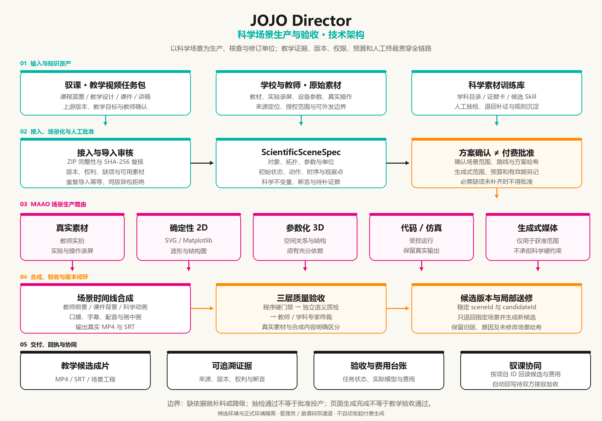

# JOJO Director

<p align="center">
  
</p>

**Scientific Scene Production Engine — 实验实训教学影像的正确性生产引擎。**

JOJO Director 面向学校与课程建设单位，把已经确认的教学内容、原始证据和素材转化为**科学正确、时序合理、可审核、可逐镜修改、可追溯**的科学场景，并按时间线组成教学影像。产品不是通用视频画布，也不以“生成一段视频”作为完成标准。

产品定义分为五层：

- **教学视频任务包**：教师侧的任务与交接单位，说明讲清什么、可用哪些素材、怎样才算合格；
- **科学场景**：JOJO 最小的生产、核查与修订单位，使用 `ScientificSceneSpec` 描述结构、参数、动作、时序与断言；
- **场景时间线**：把教师、课件、真实素材、2D/3D、代码、生成式媒体和字幕组织成教学影像；
- **MAAO 路由**：按不同场景的教学需求、模型能力、失败风险、成本和验证方式选择生产路径；
- **节点执行器**：承担实际渲染、生成、检查和合成，不作为教师理解产品的主要方式。

产品采用“**驭课制作引擎＋开放接口**”的形态：驭课负责教学意图、证据、课程蓝图、设计、课件、讲稿和教师确认；JOJO 负责科学场景审核、生产路由、2D/3D/代码/媒体生产、时间线合成、质量验收与成本回执。学校或老师也可以直接上传已有教材和课程，先形成待确认的教学策划。

> 核心边界：不让视频模型根据教材“想象”实验。先把科学内容转化为可计算、可约束、可验证的场景，再决定使用真实素材、确定性 2D、参数化 3D、代码执行或生成式媒体。

## 当前候选环境与协作文档

- **候选环境**：https://115.190.155.2/candidate/
- **当前代码与验收记录**：PR #6（`feat/science-training-library`）
- **合作者操作手册**：[JOJO科学素材合作者操作手册.md](docs/JOJO科学素材合作者操作手册.md)
- **手册适用范围**：基础医学首发合作，以及物理、化学、机械、电气、计算机、生物和运动科学等后续领域。

候选环境用于功能验收与合作者预览，不是正式生产承诺。管理员使用账号密码登录；教师和合作者使用单独发放的邀请码。账号、密码、邀请码和 API 密钥均不得写入 README、截图或代码仓库。

## 一、产品定位

### 首要客户

- 职业院校与课程建设单位；
- 需要批量生产实验、实训和原理讲解微课的教研团队；
- 需要降低课程视频返工与人工剪辑成本的制作团队。

教师个人可以作为使用者和内容确认者，但第一阶段不以低价个人订阅为主要商业假设。

### 最适合解决的问题

- 肉眼难以观察：光路、电流、分子、信号、数据结构；
- 设备昂贵或操作受限：精密仪器、自动化工作站；
- 具有安全风险：化学、高压、高温和电气实验；
- 空间关系复杂：装配、光路、机械结构、解剖结构；
- 过程过快、过慢或难以重复：反应、控制、材料变化；
- 课程持续更新：修改一个参数、步骤或知识点，不必整课重拍。

### 不优先解决的问题

- PPT 与教师实拍已经足够清楚的课程；
- 没有可靠依据，却要求 AI 生成精确实验动作；
- 只把静态配图变成没有教学作用的运镜；
- 为了“看起来是 3D”而增加成本，却不能改善学习效果。

JOJO 采用**教学必要性路由**，不是所有课件都应该视频化，也不是所有场景都应该使用 3D 或生成式视频。

## 二、与通用绘图和视频工具的差异

| 维度 | 通用绘图 / 视频工具 | JOJO Director |
|---|---|---|
| 主要交付 | 图片、视频或画布 | 成片、逐镜工程、教学断言、来源索引、验收与成本记录 |
| 科学表达 | 依赖提示词和模型通用能力 | 先形成 ScientificSceneSpec，再按约束生产 |
| 生产路线 | 以生成式模型为中心 | 真实素材、确定性 2D、参数化 3D、代码执行、生成式媒体分流 |
| 动作合理性 | 主要凭视觉判断 | 状态机、空间拓扑、参数、时序与安全规则共同检查 |
| 质量验收 | 判断画面是否美观 | 判断教学内容、空间关系、动作、时序和观察结果是否正确 |
| 课程上下文 | 通常从一段提示词开始 | 接收驭课已确认蓝图、设计、课件、讲稿和备课原始证据 |
| 模型治理 | 单模型或供应商默认路由 | 能力位显式选择 MoMA / 火山引擎，记录请求与实际返回模型 |
| 人工角色 | 最后看图 | 路线、依据、预算、专业分歧和最终采用均由人确认 |

### 已有差异化资产

- **分镜即合同**：镜头携带可核验断言，区分静帧与视频时序检查；
- **帧关卡**：首尾帧预检不通过时，避免直接进入高成本视频生产；
- **独立质检与人工终裁**：机器检查、人工改判及原因分别留存；
- **代码渲染通道**：PWM 波形、透镜光路、框图、工作站等确定性画面；
- **MAAO 路由**：按模型在特定任务上的真实能力边界选择路径；
- **素材与改判沉淀**：素材库、版本素材、改判记录及规则草稿；
- **任务与成本台账**：记录供应商、模型、任务状态、token 与可取得的费用。

MAAO 的历史数据适合用于 Replay/A-B 验证。未经同任务、同验收标准双跑，不把 Route Regret 直接宣传为已经实现固定比例的节省。

## 三、总体技术架构



```text
驭课确认课程 / 学校直接上传教材与既有课程
                    ↓
       完整素材包、版本清单、权利与来源
                    ↓
          ① 接入与导入审核台
     完整性 / 版本 / 证据 / 授权 / 缺失项
                    ↓
          ② ScientificSceneSpec
 对象 / 拓扑 / 参数 / 初始状态 / 动作 / 观察点 / 断言
                    ↓
          ③ 场景生产路由（MAAO）
  ┌───────────┬───────────┬───────────┬───────────┐
 真实素材     确定性 2D    参数化 3D    代码/仿真    生成式媒体
 教师实拍     SVG/Manim    Blender 等   受控执行     氛围与过渡
 实验录屏     Matplotlib   参数化模型   与真实输出   非关键画面
  └───────────┴───────────┴───────────┴───────────┘
                    ↓
             ④ 逐镜任务图与版本
    稳定 sceneId / shotId / taskItemId / sourceVersion
                    ↓
               ⑤ 时间线合成
 教师前景 / 课件背景 / 科学动画 / 画中画 / 配音 / 字幕 / BGM
                    ↓
          ⑥ 程序检查＋独立语义质检＋人工终裁
                    ↓
     成片、逐镜工程、来源索引、验收报告、成本与版本回传
```

### 3.1 接入与导入审核

JOJO 收到素材后先审核，不直接生产：

1. **完整性与版本**：蓝图、设计、课件、讲稿是否属于同一课次，上游版本是否匹配；
2. **科学证据**：哪些事实有正文，哪些动作缺操作规范，哪些空间关系缺结构资料；
3. **权利与出站**：素材是否自有或授权，哪些内容可以发送给外部模型；
4. **路线建议**：真实素材、2D、3D、代码执行、仿真或生成式媒体，以及理由、缺口和预算；
5. **时间线候选**：教师、课件、科学动画和真实素材如何组合，确认后才生产。

只有 PPT 配图和讲稿，通常不足以生成科学准确的 3D 操作视频。结构、尺寸、连接、操作顺序和安全要求不足时，应降级为 2D 图解或要求补料。

### 3.2 ScientificSceneSpec

每个科学场景至少包含：

```text
sceneId / pointId / sourceVersions
教学对象、目标与学段
物体、设备、仪器及角色
空间位置与连接关系
初始状态与状态转换
关键参数、单位及允许范围
必须保持不变的约束
学生需要观察的现象
可核验教学断言
缺失依据和教师确认项
```

例如 PWM 调光需要明确：周期不变、占空比按 10%→50%→90% 变化、使用同一 LED 与观察角度、平均亮度随之增强，不能把频率变化误表现为占空比变化。

### 3.3 动作与状态机

实验动作按以下链条组织：

```text
初始状态 → 操作者动作 → 设备响应 → 状态变化 → 可观察现象 → 结果与结论
```

程序先检查顺序、连接、运动方向、参数单位、设备约束和必要安全步骤；3D 场景另检查碰撞、遮挡、部件父子关系、运动范围和关键帧插值。生成式视频不承担这些硬约束。

### 3.4 时间线合成

最终视频拆成五层：

- **教学内容层**：蓝图、进度、知识点和评价；
- **教师表达层**：口播、录像、录音和字幕；
- **科学场景层**：2D、3D、实验、代码和仿真；
- **课件与原始素材层**：PPT、教材、真实录屏、设备照片和数据；
- **合成与验收层**：时间线、转场、画中画、抠像、混音和验收记录。

教师可以全程出现、只在开头结尾出现，或以画中画形式出现。合成动画必须标为动画，不冒充真实实验录像。

### 3.5 三层质量验收

| 层 | 主要检查 | 失败处理 |
|---|---|---|
| 程序硬门禁 | 结构、版本、来源、参数、拓扑、时序、权限、保留范围、文件可打开 | 阻断对应动作并定位 |
| 独立语义质检 | 图文一致、概念与动作合理、现象与结论匹配、适龄性 | 转修复或专业复核 |
| 教师 / 教研确认 | 教学取舍、专业准确性、素材采用、预算和最终发布 | 对指定版本和单元确认 |

### 3.6 模型与供应商治理

文本、图像、视频和视觉质检按能力位在 `backend/providers.yaml` 显式选择 **MoMA / 火山引擎**：

- 脚本与分镜默认 MoMA `kimi-k3`；
- 图像默认 `doubao-seedream-5-0-260128`；
- 视觉质检默认 `doubao-seed-2-1-pro-huoshan`；
- 视频默认 `doubao-seedance-2-0-260128`；
- Agent 下拉框可选择 MoMA / 火山引擎文本模型；
- 任务记录请求模型与供应商实际返回模型，不静默跨供应商降级。

当前 MoMA 模型目录未发现既有视觉 Embedding；联网 Responses/web_search 和 TTS 也未全部完成迁移。这些能力必须单独配置与验收，不因主路由迁到 MoMA 就默认具备。

## 四、与驭课的分工和交接

### 驭课负责

- 教学意图、备课原始证据和教师采用；
- 已确认蓝图、教学进度、设计和评价；
- 课件、讲稿、术语、案例和课次版本；
- 教师媒体、素材授权、保留范围和最终教学验收标准。

### JOJO 负责

- 导入审核与缺口报告；
- ScientificSceneSpec 与生产路线建议；
- 2D/3D、代码执行、真实素材和生成式媒体生产；
- 时间线合成、质量检查、成本和交付；
- 当前由驭课按项目 ID 通过 API 回读成片、候选版本和费用；JOJO 主动 Webhook 回写与正式回传包仍待双方接驳验收。

### 交接契约

最小 `yuke-micro-intro/v1` 解决单课次片头制作包导入。完整生产使用 `yuke-teaching-video/v1`，至少包括：

```text
manifest.json
course-blueprint.json
teaching-design.json
lecture-script.json
source-evidence/
slides/
teacher-media/
rights/
```

每项上游产物有独立版本；素材标注内容、视觉参考、真实操作、风格参考或教师自有等角色。教学断言不能只从关键词推断，制作路线必须可复核。

## 五、实施步骤

| 阶段 | 交付 | 验收重点 |
|---|---|---|
| DEV-01 双供应商与最小交接 | MoMA / 火山能力位、实际模型回执、单课次 ZIP 导入、可审脚本与分镜 | 不自动付费、来源版本保留、待复核镜头不能展开产线 |
| DEV-02 完整素材与审核台 | 全课程素材清单、版本与权利检查、缺口报告、场景路线建议 | 缺依据不冒充确定事实，审核后才给生产方案 |
| DEV-03 时间线合成 | 教师前景、课件背景、科学动画、真实素材、字幕配音与画中画 | 同一口播源、镜头时序正确、合成结果可预览 |
| DEV-04 科学场景扩展 | 2D 模板库、参数化 3D、代码与仿真通道、学科规则包 | 先验证科学规格与动作，再验证视觉质量 |
| DEV-05 生产治理 | 学校/项目权限、统一预算、幂等、查单、取消、迟到结果隔离、版本回滚 | 越权、重复扣费、重复创建和旧版本覆盖被阻断 |
| DEV-06 试点与开放接口 | 真实课程试点、驭课回传、API/MCP、成本与质量基线 | 真实教师验收、合格成片分钟成本与人工修改时间 |

## 六、最终呈现成果

每个课次可交付：

1. **教学成片**：MP4、字幕、配音和必要的教师前景；
2. **逐镜工程**：sceneId、shotId、制作路线、参数、输入输出和版本；
3. **科学场景说明**：ScientificSceneSpec、状态转换和教学断言；
4. **来源与权利索引**：蓝图、设计、课件、讲稿、原始证据及授权；
5. **验收报告**：程序检查、独立语义质检、人工终裁和改判原因；
6. **成本与运行回执**：供应商、实际模型、任务号、耗时、token 或费用；
7. **可复用资产**：2D 模板、3D 模型、代码渲染、学校素材和规则包；
8. **驭课回传包**：成片、版本、验收、成本及继续修订入口。

### 市场验证指标

- 一次验收通过镜头比例；
- 每个验收合格成片分钟的总成本；
- 教师人工修改分钟数；
- 单镜平均重试次数；
- 教学断言漏判与误判；
- 来源、版本与权限绑定完整度；
- 重复付费、越权和旧版本覆盖事件，目标均为 0。

## 七、学校或老师直接接入已有课程

支持三种方式，但当前网页表单的格式范围必须如实区分：

- **通过驭课接入**：教学依据与确认链最完整，优先推荐；
- **当前教师投稿表单**：单文件支持 MP4、MOV、WebM，PNG、JPG、JPEG、WebP，以及 PDF；文件夹上传还支持 UTF-8 的 TXT、Markdown 和 CSV，保留相对路径并在后台进行本地格式检查、哈希去重和待审核归类；DOCX、PPTX、ZIP 等资料目前由管理员另行安排导入，不能通过修改扩展名绕过；
- **校本资产连接**：按学校、课程和角色授权，原始资料保留在校内，只把批准的内容送往模型。

直接上传教材不等于已确认课程。老师仍需确定授课对象、课次、时长、学习目标、必学点、素材范围和专业审核人。素材上传成功不等于科学审核通过，更不等于批准投产。

## 八、当前实现与边界

### 已实现

- React + React Flow 画布、FastAPI + SQLite 后端；
- 脚本、分镜、图像、视频、代码渲染、质检、配音、拼接与验收台；
- MAAO 能力地图、规则包、素材库、改判记录和成本台账；
- MoMA / 火山引擎能力位选择与旧 `bjmoma` 视频配置兼容；
- `yuke-micro-intro/v1` 单课次片头 ZIP 导入，保存来源版本与可审分镜；
- `yuke-teaching-video/v1` 清单校验、素材 SHA-256 复核、场景路线建议、缺项与版本化审核回执；
- 相同任务包重复导入返回原任务，同版本不同内容被拒绝；
- 导入项目的任务导航、场景时间线与场景级详情，不展示旧节点入口，底层执行器继续兼容既有项目；
- 方案确认记录包含包哈希、方案哈希、场景范围、无需付费生成及确认时间；
- 确定性 2D 与已有素材生成真实 MP4 和 SRT，候选状态为 `pending_acceptance`；
- 指定场景送修产生新候选，保留旧版及未修改场景哈希；
- 科学素材训练库提供九类学科目录、3 个候选 Skill 和 100 条外部发现的浏览与筛选；
- 人工抽检记录绑定候选内容哈希并追加保存，支持抽检通过、退回补证和退回修改，但不会自动批准投产；
- PWM 渲染器跨平台选择中文字体，缺少中文字体时明确停止，避免输出方框字；
- 手动中文 / English 切换并保存选择；课程、场景、口播、断言和训练库首批候选提供经登记的英文显示，切回中文可核对原文；
- 主页账号按钮显示当前身份，支持退出与切换；管理员账号密码和邀请码双通道认证，邀请码支持额度、停用与用量记录；
- 文件夹上传保留相对路径，后台执行格式签名校验、内容哈希去重和本地规则归类，逐文件返回接收/拒绝/重复回执；不调用付费模型，结果仍需人工审核；
- 上传批次持久化保存分析结果，支持教师提出修改意见、暂时归档和管理员/技术团队对齐；归档不等于批准投产；
- 首页提供品牌演变视频，默认显示最终标识，点击后播放，结束自动回到封面；
- 三栏工作区支持拖动手柄、右栏加宽/变窄按钮、键盘微调和本机宽度记忆；
- 支持按项目或训练库生成可分享的候选路径，候选 API、静态资源与正式后端隔离；
- 待复核导入镜头不能展开为付费产线。

### 仍需逐步完成

- 驭课侧完整任务包导出与自动回传，以及学校真实课程的成片验收和归档；
- 教师素材上传后与指定场景的绑定、教师界面的候选版本列表与中断任务自动恢复；
- 教师前景、课件背景和科学生产的统一时间线；
- 新课程的英文内容翻译与专业审核，以及已有中文视频的英文版渲染；
- 参数化 3D 与更多学科场景库；
- 学校/项目级权限、统一 Agent 额度检查和外部任务 `external_unknown`；
- MoMA 图像、Embedding、联网调研和 TTS 的全量迁移验收；
- 真实学校试点与严格 Baseline / MAAO A-B 数据。

## 九、快速上手

**前置条件**：Python 3.11+、Node 20.19+、ffmpeg。无付费候选样例只需要本地渲染环境；调用 MoMA 或火山模型时才需要对应账号和密钥。生成费用由使用者承担，一部 2 分钟微课的直接生成成本需按实际模型和返工情况核算。

```bash
# 1. 后端
cd backend
pip install -r requirements.txt
cp .env.example .env
# 在 .env 中设置 ADMIN_USER 和 ADMIN_PASS；两者必须同时存在才启用管理员认证
# 调用 MoMA 时配置 BJMOMA_API_KEY；火山备选配置 ARK_API_KEY
# 编辑 providers.yaml：按能力位选择 moma / ark，并换成账号实测可用的模型 ID
python -m uvicorn app.main:app --port 8000

# 2. 前端（另开终端）
cd frontend
npm install
npm run dev                     # 打开 http://localhost:5173
# 隔离验收时可用 VITE_API_PROXY_TARGET=http://127.0.0.1:8001 指向独立后端
```

候选环境若部署在 `/candidate/`，前端构建必须同步设置 `VITE_BASE_PATH=/candidate/`，确保 API、图片、视频和字幕不会误走正式后端。生产部署前必须启用管理员认证，不得使用开发模式对外开放。

首页可以：

- 通过顶部“中文 / English”手动切换界面语言；
- 通过主页账号按钮查看当前身份、退出或切换账号；合作者使用管理员发放的邀请码进入；
- 输入教学需求，由 Agent 规划脚本与分镜；
- 选择“导入驭课 ZIP”，导入单课次片头制作包；
- 选择“导入教学视频包”，审核 `yuke-teaching-video/v1` 的场景、素材、版本和待补项；
- 进入“科学素材训练库”，按学科浏览候选 Skill 与外部发现，保存人工抽检意见；
- 在画布中逐镜生产，或在验收台进行人工终裁。

多课次 ZIP 请分课导入。导入只代表候选交接，不代表路线与教学断言已复核，不自动展开产线或发起付费生成。外部视频标题、AI 摘要和社区标签只用于候选发现，不是科学真值；训练库中的“抽检通过”也不等于批准 Skill 投产。Linux 渲染环境需安装 Noto Sans CJK 等中文字体。

## 十、目录结构

```text
backend/
  app/                 FastAPI：节点执行器、模型网关、质检、MAAO、导入与素材
  app/render/          确定性 2D 渲染模板
  prompts/             外置提示词
  qc_rules/            学科与课题质检规则、草稿规则
  tools/               改判记录归纳与外部发现导入工具
  tests/               离线契约、工作流与真实模型回归
  schemas/             教学视频任务包、证据卡与 Skill JSON Schema
  skills/              候选 Skill、场景规格与质检规则
  training/            学科分类、来源映射与授权说明
  providers.yaml       能力位、供应商、模型与成本配置
  capability_map.yaml  模型能力地图与分镜路由
frontend/              React + React Flow 画布、验收台、训练库与素材库
reports/training/      外部发现候选与分布统计（不等于科学可用率）
docs/                  MAAO、学科接入和驭课协同文档
```

## License

Apache-2.0 · Copyright 2026 Baggio200cn

教学演示成片与文档中的生成内容均由 JOJO Director 产线生成；正式教学采用仍需按来源、专业规则与人工验收流程确认。
